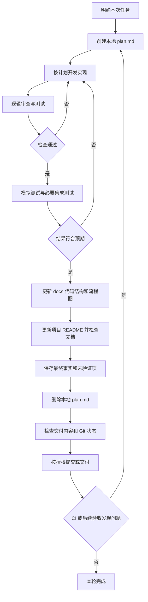

# 所有项目通用的开发与交付规范

本文件可复制到不同项目复用。它规定做事的顺序和交付标准，不记录某个项目的业务、具体模型、机器配置或运行结果。

核心流程固定为：

**创建计划 → 开发实现 → 逻辑测试 → 模拟测试 → 更新 docs 的代码结构和流程图 → 删除计划 → 交付。**

环境准备固定为：

**识别技术栈 → 下载或复用解释器/运行时 → 创建项目隔离环境 → 配置依赖 → 安装依赖 → 验证环境 → 输出结果。**

本文件是通用规范，不是安装脚本。每个项目都应按实际技术栈实现一键入口，并在自己的 README.md 中写明可执行命令；不得把本文示例当成项目已经存在的功能。

## 1. 三种文件的职责

| 文件 | 职责 | 保存方式 |
| --- | --- | --- |
| `all_project_readme.md` | 所有项目可复用的开发、环境、测试、文档与交付规范 | 长期维护，可提交 Git |
| `README.md` | 当前项目独有的目标、功能、技术栈、环境、依赖、配置、运行与验收说明 | 长期维护，可提交 Git |
| `plan.md` | 当前一轮任务的目标、步骤、风险、验证方式和进度 | 仅本地临时使用；不跟踪、不暂存、不提交、不推送；完成后删除 |

计划文件统一命名为 `plan.md`，仅在本次任务执行期间保留。

## 2. 每轮任务先创建计划

在改代码、改配置或整理文档之前，先在根目录创建 `plan.md`。已有未完成计划时，先阅读并承接，不能无声覆盖。计划至少包含：

- 本次目标、验收标准和明确不涉及的范围。
- 当前状态、需要阅读的代码和参考资料。
- 分步实施顺序及受影响文件。
- 环境、依赖、配置、数据迁移及兼容风险。
- 逻辑测试、模拟测试、实际环境测试各自如何验证。
- 需要更新的 docs 和项目 README。
- 尚未解决的问题、当前进度和下一步。

可使用以下内容作为本地计划模板：

```markdown
# 本次任务计划

## 目标与范围
- 要解决的问题：
- 验收标准：
- 不涉及的范围：

## 实施步骤
1. [ ] 阅读当前代码、依赖与相关文档。
2. [ ] 实现功能或修复问题。
3. [ ] 第一轮逻辑审查与静态检查。
4. [ ] 第二轮逻辑测试、边界和异常测试。
5. [ ] 模拟测试，必要时实际集成测试。
6. [ ] 更新 docs 代码结构、代码流程图和项目 README。
7. [ ] 检查交付内容，将最终事实写入永久文档。
8. [ ] 删除本计划，确认 Git 中没有计划文件。

## 风险与待确认事项
- 环境/依赖/兼容风险：
- 未验证内容及原因：
```

计划变化时先更新本地计划，再继续实现。计划是执行依据，不是最终交付物，不把整份临时计划复制到 README 或 docs 中。

### 各阶段的完成标准

| 阶段 | 开始前具备 | 完成时留下的证据 |
| --- | --- | --- |
| 计划 | 用户目标与当前项目状态已明确 | 本地步骤、影响范围和验收方式；未知项明确标记 |
| 开发 | 能解释修改原因与受影响行为 | 可审查的改动；配置/迁移兼容性说明 |
| 逻辑测试 | 输入、输出、失败契约已定义 | 关键正常/异常/边界测试的结果，不仅是语法通过 |
| 模拟测试 | 外部依赖和替身边界明确 | 调用顺序、传参、失败/超时、清理与报告的可复现证据 |
| docs 更新 | 实现与验证结果基本稳定 | 反映最终代码的结构、流程和使用说明，链接可用 |
| 删除计划 | 必要事实已进入永久文档 | 本地计划已删除，索引/暂存区中没有计划 |
| 交付 | 变更与风险已汇总 | 测试层级、未验证项、交付状态明确；推送须处于授权范围 |

缺少真实硬件或外部账号时，只能完成对应的工程检查，不能把目标环境验收一并标记完成。遇到新的问题时，回到受影响阶段，而不是为完成清单忽略问题。

## 3. 一键准备解释器、虚拟环境和项目依赖

每个项目应提供一个清晰的一键环境准备入口。入口名称由项目技术栈决定，例如 `scripts/setup.sh` 或 `scripts/setup.ps1`；这些只是约定示例，必须实现后才能写成可用命令。

一键入口应依次执行：

1. **识别环境。** 检查操作系统、CPU 架构、权限、磁盘、网络和项目要求的硬件。
2. **准备解释器或运行时。** 读取项目声明的版本，优先复用兼容版本；缺失时从官方或可信来源下载安装，并验证版本/架构。无法自动处理时明确报错，不修改系统默认解释器来强行适配。
3. **创建隔离环境。** 使用项目专属环境，避免污染系统和其他项目；已有兼容环境可复用，版本不兼容时给出明确的重建方案。
4. **配置依赖。** 维护依赖声明、锁文件、下载源和平台约束；区分运行依赖、开发依赖、测试依赖、系统依赖。
5. **安装依赖。** 使用项目环境中的包管理器，按锁定版本安装；避免全局安装、混用多个包管理器或随意追随最新版本。
6. **验证环境。** 检查依赖冲突、关键模块导入、原生扩展、设备访问和必要的最小功能。
7. **输出结果。** 报告解释器路径、实际版本、隔离环境位置、成功/失败阶段与日志位置，不打印凭据。

### 按技术栈使用隔离机制

| 技术栈 | 隔离与依赖约定 |
| --- | --- |
| Python | 项目内 `.venv`，通过项目解释器调用 pip 或项目选定的包管理器；依赖声明和锁定方式写入 README |
| Node.js | 固定兼容 Node 版本，依赖安装到项目，选定一种包管理器并维护对应锁文件 |
| Java / .NET | 固定所需 JDK/SDK 版本，使用项目构建与依赖声明；不照搬 Python 的虚拟环境方案 |
| Go / Rust 等 | 固定工具链与模块依赖；构建缓存、依赖缓存和源码分离 |
| 混合项目 | 分别说明前后端或各子模块运行时，并用总入口按依赖顺序准备 |

Python 的基础操作示例（实际版本由项目决定）：

```bash
python -m venv .venv
```

Linux/macOS 项目环境示例：

```bash
.venv/bin/python -m pip install -r requirements.txt
.venv/bin/python -m pip check
```

Windows PowerShell 项目环境示例：

```powershell
& .\.venv\Scripts\python.exe -m pip install -r requirements.txt
& .\.venv\Scripts\python.exe -m pip check
```

这些示例假定对应项目已有依赖文件，并不替代解释器下载和完整一键脚本。虚拟环境不提交 Git，不从另一台机器直接复制当作可移植环境。

### 一键入口的质量要求

- 可重复运行：成功步骤和已有缓存尽量复用，不默默删除用户环境或数据。
- 支持阶段定位和恢复：区分环境准备、依赖安装、数据下载、启动与测试。
- 非交互执行不能无限等待密码或输入；缺少授权/配置时尽早明确报错。
- 根据项目需要提供检查模式、超时和有限重试；不能无限重试掩盖错误。
- 下载失败、版本不符、依赖冲突和必要资源不足必须返回非零退出码。
- 自动操作限于项目声明的适配范围，不擅自替换产品、核心模型或数据库来绕过要求。

### 一键入口应有明确契约

项目 README 应列出每个入口的前提、是否联网、是否修改环境、成功产物、失败退出码和重跑方式。环境检查、安装、数据下载、快速测试与完整验收不能使用含糊的同一个“成功”。

昂贵操作之前先做低成本配置检查：空参数、路径冲突、输出格式、缺少授权、无效超时值等不应在下载大量数据或长时间计算后才发现。资源检查需区分总量和可用量，容器配额不能忽略。

把配置传给执行器前统一路径规则，避免检查的是一个目录、实际写入的是另一个目录。失败后的中间文件、缓存和环境应有确定状态；输出存在或子进程退出码为零都不足以独立证明本次任务成功。

## 4. 开发实现与开源参考

开发前先理解现有代码和适用的上游项目：入口、模块职责、目录结构、配置方式、测试方法、许可证和扩展接口。

参考开源项目的组织方式，不盲目复制全部目录或依赖。记录采用的上游版本/提交和接口，不混用不同版本的代码示例。当前项目的选择与取舍写进自己的 README 或 docs，不写进本通用规范。

实施时保持模块职责清晰，核心业务逻辑与外部系统、文件操作、网络和设备调用适当分离，使逻辑测试和模拟测试可以独立运行。保护用户已有改动；迁移和破坏性操作必须有明确范围与恢复方式。

## 5. 统一目录与路径规划

各项目应在 README 中选定并记录自己的路径，不把某台开发机的绝对路径写死在代码里。以下是通用分工，具体项目可以按技术栈调整：

| 类别 | 约定示例 | 要求 |
| --- | --- | --- |
| 源代码 | `src/` 或已有小型模块布局 | 职责清晰，不为目录形式随意搬动代码 |
| 自动化脚本 | `scripts/` | 安装、启动、测试和维护入口可查 |
| 配置模板 | `config/`、示例配置 | 不包含真实凭据，写清优先级 |
| 自动测试代码 | `tests/` | 可重复、可纳入 CI，提交版本控制 |
| 本地模拟试验 | `test/` 或项目指定临时目录 | 实验产物不提交；永久测试用例放 `tests/` |
| 文档 | `docs/` | 代码结构、流程图、接口、部署与排障 |
| 隔离环境 | `.venv/` 或技术栈对应目录 | 与源码/数据分离，不提交 |
| 缓存 | `.cache/` 或可配置缓存根 | 与正式数据区分，可诊断和重建 |
| 数据与产物 | `data/`、`outputs/` 或外部挂载 | 明确来源、生命周期、容量和备份 |
| 日志与测试报告 | `logs/`、`reports/` | 运行标识一致，避免覆盖历史结果 |
| 临时计划 | 根目录 `plan.md` | 本地临时、不跟踪、任务结束删除 |

相对路径必须明确以项目根、配置文件目录还是当前工作目录为基准。空格、中文、路径分隔符和跨平台行为需要考虑。创建/清理目录前验证边界，不把缓存清理误变成数据删除。

## 6. 参数与依赖配置规范

- 参数应有名称、类型、默认值、允许范围、必填条件和错误提示。
- 明确命令行、环境变量、配置文件与默认值的优先级，实际代码必须与文档一致。
- 区分可覆盖参数与固定约束；未实现的配置项不得写成已支持。
- 密钥、token、密码由安全的外部配置提供，不写入源码、日志、测试样例或提交历史。
- 固定可兼容的解释器、关键依赖和外部服务/模型版本，升级前验证兼容性。
- 锁文件、版本记录、下载校验和恢复方式按项目重要程度落实；没有做的不能声称已做。
- 缓存、输入、输出、日志和临时目录各有明确用途，避免互相覆盖。

## 7. 多进程、多线程与资源配置

不能仅写“支持并发”；必须写清并发对象、限制、控制入口和测试结果。

| 维度 | 每个项目必须明确的事项 |
| --- | --- |
| 进程 | 主进程/子进程职责、数量、是否串行或并行、生命周期、失败传播 |
| 线程 | 业务线程与第三方运行库线程的区别、默认值、配置入口、是否真实生效 |
| CPU / 内存 | 并发预算、峰值占用、容器配额、限流条件 |
| GPU / 加速设备 | 设备分配、显存预算、任务独占或共享、资源不足行为 |
| I/O / 下载 | 连接数、下载并发、重试、带宽/磁盘限制 |
| 共享状态 | 锁的范围、缓存争用、文件原子写、数据库事务或队列 |
| 中断与退出 | 超时、取消、子进程回收、线程退出、临时文件与资源清理 |

先建立稳定的串行基线，再根据实测决定是否并行。不要默认把 worker/线程数设成 CPU 核数就认为最优。跨进程、跨目录、跨机器的锁范围必须分别说明。

需要时暴露经过验证的并发参数，并记录它们影响哪个层级；第三方库的线程环境变量不一定控制全部工作。并发变更应包含竞争、死锁、过载、取消和异常退出测试。

## 8. 统一日志与报告规划

每次执行应有唯一运行标识，将日志、步骤耗时、测试报告和输出路径关联起来。至少记录：

- 时间和时区、运行标识、阶段、必要的进程/任务标识。
- 错误等级、错误原因、退出码及下一步恢复方式。
- 各阶段耗时、必要的版本信息和最终状态。
- 输入/输出的可定位信息；避免记录完整敏感内容。
- 成功、失败、超时、跳过、未执行和运行中等状态，不混为一谈。

日志位置、命名、保留期限、轮转/归档、容量上限和清理方式在项目文档中明确。没有日志轮转或自动脱敏时，必须标注未实现，不默认认为已有。

失败不能仅打印一条信息后仍返回成功；存在旧产物也不能证明本次成功。进程被强杀或机器断电时，running 状态、未完成文件和回收方式需要有解释。

监督进程需能处理常规取消信号：停止当前子任务、等待回收、记录取消状态，防止主命令退出后工作进程仍占用资源。无法捕获的强杀/断电应单独标注，不把正常终止时的清理缺失归为不可避免。

## 9. 多轮逻辑检查与逻辑测试

第一轮审查实现是否满足计划：入口、参数、数据流、边界、权限、路径、依赖、兼容和错误处理。

第二轮执行适合改动范围的检查与测试：

- 语法、格式、静态分析、类型或构建检查。
- 正常业务路径及期望输出。
- 空值、边界、非法组合、缺失配置、损坏输入和版本不符。
- 资源不足、重复执行、超时、失败传播及恢复。
- 本次修改涉及的回归路径。

失败后修复，再重测受影响部分；只有新改动、失败或未解决风险才扩大测试范围。不要靠重复运行相同的通过用例充当“多轮检查”。纯文档任务可检查链接、示例、参数一致性和流程完整性，不为了数量制造无关测试。

## 10. 模拟测试与实际测试分层

逻辑测试通过后，对外部依赖和完整流程做模拟测试：使用 mock、stub、fake、临时目录、固定输入和可控错误，验证请求顺序、参数传递、报告与失败恢复。

至少根据项目需要覆盖：正常流程、部分失败、无网络/不可达服务、缺失文件、损坏缓存、超时、重复执行、取消和未执行分支。

| 层级 | 用途 | 必须说明的边界 |
| --- | --- | --- |
| 逻辑测试 | 验证函数、规则、边界和模块契约 | 不等于外部服务实际可用 |
| 模拟测试 | 验证编排、调用参数、错误处理、恢复与报告 | 不等于真实设备/服务/模型已运行 |
| 实际集成测试 | 使用真实依赖、文件格式或测试服务验证接口 | 不等于生产规模和压力下稳定 |
| 目标环境验收 | 验证真实部署、完整流程和业务结果 | 仍需明确数据范围、负载与质量标准 |

把预期结果与实际结果、通过/失败/跳过原因记清楚。缺少目标环境时，完成可执行测试并明确待验收项，不能伪造测试或把 mock 成功写成实际成功。

测试矩阵至少覆盖任务相关的下列维度：

| 情景 | 需要观察的结果 |
| --- | --- |
| 全新环境 | 是否按顺序创建环境、安装、下载和执行 |
| 已有环境/缓存 | 是否复用，是否拒绝不兼容版本和不完整状态 |
| 配置错误 | 是否在昂贵步骤前失败，是否明确指出参数 |
| 部分失败 | 已通过部分、失败部分、未执行部分是否正确区分 |
| 超时/取消 | 子任务是否停止、资源是否回收、报告是否最终落盘 |
| 存在旧产物 | 是否验证本次新产物，是否在失败时保留旧数据而不误报成功 |
| 重试恢复 | 是否可按文档恢复，是否避免破坏正常缓存或用户数据 |

可直接运行的小型真实子进程、临时文件和本地媒体测试，应优先用于验证进程/文件语义；仅模拟返回值无法证明这些行为。

## 11. 测试后更新 docs 的结构和代码流程

以最终实现为准更新，不以最初计划或愿景为准。每轮至少检查以下文档是否需要变化：

- `docs/code_structure.md`：目录、模块职责、公共入口、依赖关系、配置位置、数据/日志路径和测试映射。
- `docs/code_flow.md`：启动、环境准备、主业务、分支、输入输出、错误处理、超时、取消、资源释放和报告生成。
- `README.md`：项目专属环境、安装/运行命令、参数示例、验收和排障。
- 其他受影响的接口、配置、迁移、部署文档。

代码流程图可使用 Mermaid，并保留文字解释。图中应区分已实现分支和待实现能力，不能把并发流程画成串行或省略关键失败路径。检查链接、文件名、命令和图表语法，确认读者能按文档操作。

通用开发流程图：



## 12. 最后删除计划，防止进入版本历史

完成实现、检查、逻辑测试、模拟测试及 docs 更新之后，先把必须保留的最终事实整理到永久文档，再删除根目录 `plan.md`。不要把待办计划作为项目使用说明提交。

Git 项目建议在 `.gitignore` 中加入：

```gitignore
# Local temporary plans; never publish.
[Pp][Ll][Aa][Nn].[Mm][Dd]
```

忽略规则不会自动解除已经被跟踪的文件。检查时分别确认工作区、索引、暂存区和历史：

```bash
git status --short
git ls-files -- plan.md PLAN.md
git diff --cached --name-only
git check-ignore -v --no-index -- plan.md PLAN.md
```

被忽略的计划可能仍显示在编辑器文件树里，**文件存在不等于 Git 正在跟踪**。若已经被跟踪，需要明确执行解除跟踪；若已经进入远程历史，是否重写历史应按该项目授权处理，不能把普通删除冒称为历史清除。

最终交付前确认：计划文件已删除、没有暂存计划、没有凭据或运行产物，文档记录了真实测试结果。发现新问题时重新创建计划，再走一轮闭环。

## 13. 其他需要提前考虑的事项

| 事项 | 需要落实或明确的内容 |
| --- | --- |
| 版本与可复现性 | 解释器、依赖、系统库、上游代码、外部数据版本及升级验证 |
| 安装与网络 | 下载源、代理、证书、认证、断点恢复、离线安装是否真正支持 |
| 权限与安全 | 最小权限、敏感配置、数据权限、上传/回传范围和许可证 |
| 数据与备份 | 数据格式、大小、完整性、迁移、备份、回滚和误删防护 |
| 性能与容量 | CPU、内存、显存、磁盘、带宽、长任务耗时和成本 |
| 可运维性 | 健康检查、阶段报告、监控、告警、退出状态、重试与恢复 |
| 兼容性 | 操作系统/架构差异、路径/编码、原生扩展、容器与宿主边界 |
| 业务验收 | 正确性、质量、响应时间和允许失败范围，不能仅凭“程序没报错”通过 |
| 自动化边界 | 已实现的一键能力、仍需人工的前提，以及未实现的配置和服务 |
| 文档维护 | 每次修改后更新最终结构和流程，避免说明与代码分离 |

这些内容的具体数值、命令和实施状态填写在各自项目的 README 或 docs 中。本文件只维护可复用的规则，不积累某个项目的专用配置和临时计划。

## 14. 按本规范审查一个现有项目

先清点入口脚本、依赖声明、配置、实际路径、日志、进程关系、测试与 docs，再按主流程逐段审查。不要只读 README，也不要只看测试是否全绿。

每个发现应记录：

| 字段 | 要求 |
| --- | --- |
| 位置与触发条件 | 文件/模块及触发问题的具体输入或状态 |
| 现象与影响 | 预期和实际差异；是阻止运行、误报成功、遗留资源还是文档缺失 |
| 证据 | 最小复现、测试输出或可核对的代码路径 |
| 优先级 | 按实际影响排序，区分必修缺陷与后续改进 |
| 处理 | 已修复、待验证、已知限制或本次范围之外，说明原因 |
| 回归与交付 | 验证方法、结果、目标环境限制及需要更新的文档 |

审查结束应给出明确结论：哪些问题已修、哪些测试已执行、哪些仍待真实环境确认。项目专属审查结果放在项目 docs 或审查记录中，不混入本通用文件。

最终交付清单：目标和实现一致；逻辑/模拟测试通过或明确列出阻塞；配置与路径能定位；日志和失败可恢复；docs 结构/流程与代码一致；计划已删除且未跟踪；未提交凭据、环境和运行产物；没有把未验证能力写成已经完成。
