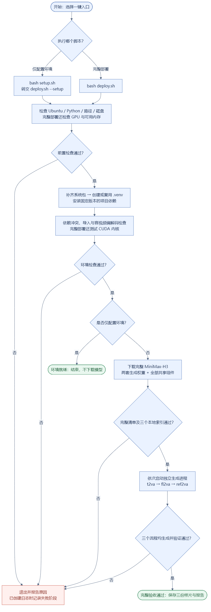
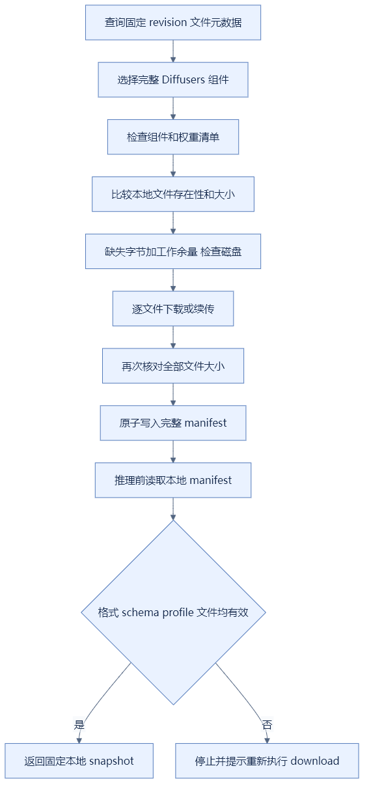
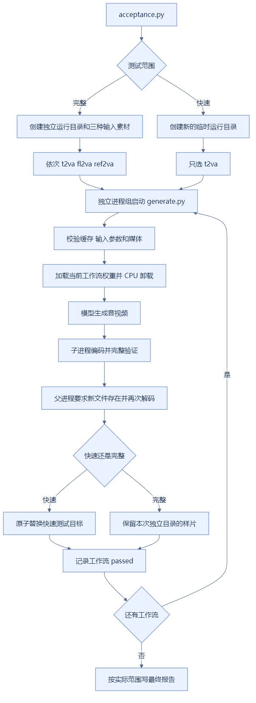
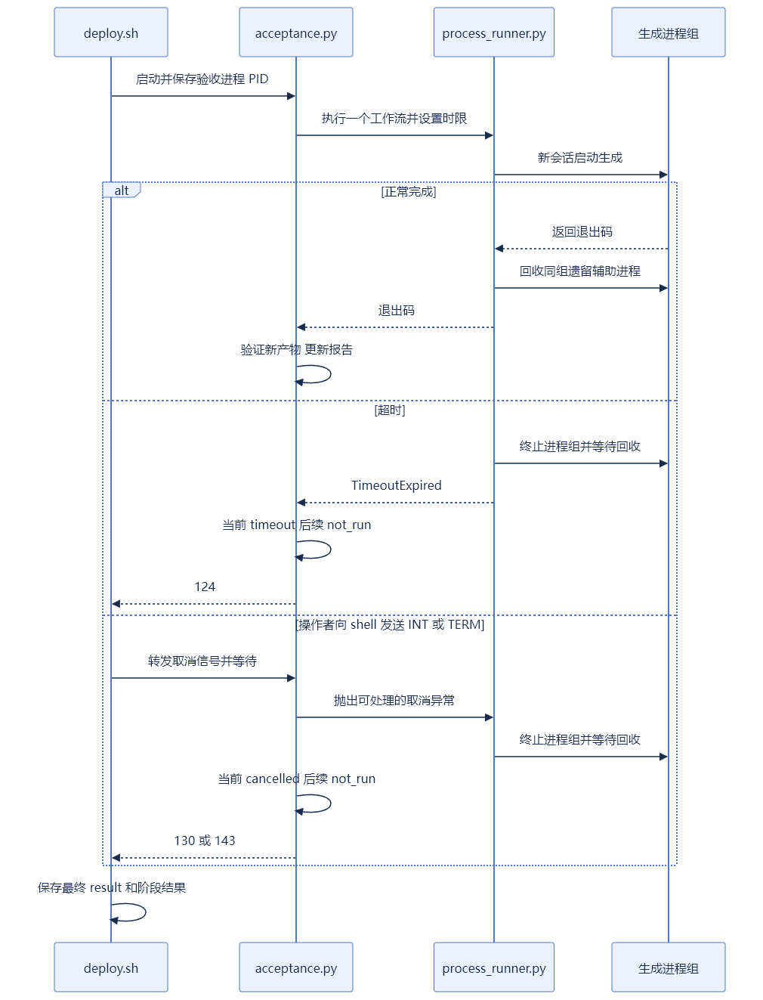

# MiniMax-H3 代码执行流程

**[直接打开流程图查看页](diagrams/index.html)**：离线查看图片、缩放和下载，无需 Markdown 插件。

模块对应关系见 [代码结构](code_structure.md)，具体运行命令见 [项目 README](../README.md)。本文件描述实际代码，不将模拟检查等同于完整 GPU 验收。

## 1. 默认一键部署

[查看可缩放 SVG](diagrams/deployment.svg) · [可编辑源文件](diagrams/deployment.mmd)

前置阶段任一步失败也会停止后续执行。日志启动前的错误可能仅写终端；日志启动后的常规退出写 result/stages。输出与提示词校验在安装依赖、下载模型之前，但缺少 Python 时解释器安装发生在此校验之前。

## 2. 各模式的真实执行范围

| 模式 | Python/系统/依赖安装 | GPU与推理RAM检查 | 完整下载 | 本地索引检查 | 推理 |
| --- | --- | --- | --- | --- | --- |
| 默认 all | 是，复用兼容环境 | 是 | 是，复用缓存 | 是 | 三流程 |
| `--setup` | 是 | 否 | 否 | 否 | 否 |
| `--prepare` | 是 | 否 | 是 | 是 | 否 |
| `--download` | 否 | 否 | 是 | 是 | 否 |
| `--check` | 否 | 是 | 否 | 是 | 否 |
| `--test` | 否 | 是 | 否 | 是 | 仅 t2va |
| `--test-all` | 否 | 是 | 否 | 是 | 三流程 |
| `--preflight` | 否 | 是 | 否 | 否 | 否，无日志文件 |

除 `--preflight` 外，正常执行均经过运行时检查；无 GPU 模式仅测试 CPU 导入/编解码。测试模式启用离线模型访问，缺少模型文件会停止并提示 `--download`。

## 3. 缓存下载与损坏恢复

[查看可缩放 SVG](diagrams/cache.svg) · [可编辑源文件](diagrams/cache.mmd)

原有完整文件不会因为 manifest 重建而重下载。文件存在性/大小检查不包含内容 hash 全检；同大小内容损坏是已知限制。异常 manifest JSON、非对象顶层或错误 file map 现在给出统一可操作的恢复提示。

## 4. 验收、生成与新产物发布

[查看可缩放 SVG](diagrams/generation.svg) · [可编辑源文件](diagrams/generation.mmd)

生成子进程退出 0 只是必要条件；还必须有本次新文件且验证通过。快速测试失败不会覆盖旧成功样片；完整验收使用新的运行目录。`all_workflows_passed` 只在三个工作流均成功时为 true。

## 5. 失败、超时与常规取消

[查看可缩放 SVG](diagrams/cancellation.svg) · [可编辑源文件](diagrams/cancellation.mmd)

本图针对生成验收阶段；安装/下载还由各自工具处理终止，不宣称已有通用的全过程任务管理器。SIGKILL、断电和资源内核强杀无法保证最终报告落盘；不能把残留 running 报告当作成功。

## 6. 修改后的验证顺序

按通用规范先建本地计划，再实现；逻辑检查和回归后，使用替身命令模拟昂贵操作，使用真实小进程验证超时/取消，使用真实 CPU 媒体验证格式和接口。最后更新本文件和代码结构，删除计划后交付。

流程图与模拟测试不能替代目标机器的完整权重加载、三流程生成、资源峰值和画质验收。具体本次执行事实见 [project_review.md](project_review.md)。
