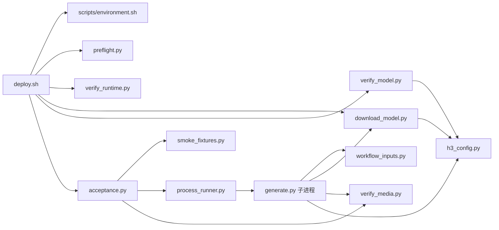

# MiniMax-H3 项目代码结构

本文件记录当前项目实现，不作为跨项目模板。通用开发流程见根目录 [all_project_readme.md](../all_project_readme.md)，实际操作见 [README.md](../README.md)，执行流程见 [code_flow.md](code_flow.md)。

## 目录与文件职责

```text
项目根/
├── all_project_readme.md          # 可复用开发规范
├── README.md                     # 本项目环境、参数、运行说明
├── HANDOFF.md                    # 目标机器交付步骤
├── AUDIT.md                      # 历史审查记录
├── deploy.sh                     # 一键部署、阶段、锁、日志与退出处理
├── scripts/environment.sh        # Python 发现和 apt 系统包安装
├── requirements-torch.txt        # 固定 CUDA torch/torchvision 配对
├── requirements.txt              # 固定直接运行依赖和 Diffusers 提交
├── h3_config.py                  # 模型、revision、组件、工作流、清单版本
├── preflight.py                  # 输出/提示词、GPU、RAM、容器限额、磁盘检查
├── download_model.py             # 完整模型下载、缓存升级与清单验证
├── verify_runtime.py             # 真实依赖导入、CUDA 内核和小型媒体检查
├── verify_model.py               # 三个工作流的本地索引/权重路由检查
├── acceptance.py                 # 快速/完整验收、逐工作流报告及产物发布
├── process_runner.py             # 生成子进程、超时与取消、Linux 进程组回收
├── smoke_fixtures.py              # 诊断用图片、视频、音频素材
├── generate.py                   # 单次模型加载、调用、输出
├── workflow_inputs.py            # 首尾帧/混合参考校验与解码
├── verify_media.py               # 临时编码、完整解码验证、原子替换
├── tests/                        # 可复现自动测试
│   ├── test_deployment.py        # 参数、缓存、资源和原子输出
│   ├── test_handoff.py           # Ubuntu Bash 编排与 shell 取消
│   ├── test_workflows.py         # 工作流、完整缓存、验收报告和失败传播
│   ├── test_review_regressions.py # 本轮清单/旧产物/参数/进程回收回归
│   ├── test_cpu_integration.py   # 真实 CPU 库、索引与媒体接口
│   └── fixtures/                # 固定官方索引，测试时不加载权重
├── docs/
│   ├── code_structure.md         # 本文
│   ├── code_flow.md              # 实际代码流程图
│   └── project_review.md         # 本轮问题、证据、修复与验证边界
└── .github/workflows/checks.yml  # Ubuntu 非模型回归与 CPU 集成 CI
```

运行时目录 `.venv/`、`.cache/`、`logs/`、`outputs/` 和本地实验 `test/` 均不提交 Git。临时 `plan.md` 只用于本轮任务，完成后删除，不纳入永久目录清单。

## 模块与数据边界

| 模块 | 输入/输出 | 不承担的工作 |
| --- | --- | --- |
| `deploy.sh` | 环境变量与模式 → 分阶段调用、result/stages/log | 不实现模型推理或业务并行池 |
| `environment.sh` | 已有解释器/apt 候选 → 兼容 Python/系统包 | 不改系统 Python 链接，不安装驱动 |
| `preflight.py` | 提示词、输出路径、GPU、缓存盘 → 通过/明确异常 | 不下载或加载模型 |
| `download_model.py` | 固定 revision 的远程文件元数据 → snapshot + 完整 manifest | 不重复下载另一框架的原始格式，不做内容 hash 全检 |
| `verify_runtime.py` | 已装依赖及可见 GPU → 导入/内核/编解码结果 | 不用完整 H3 权重推理 |
| `verify_model.py` | 已校验本地 snapshot → 三工作流路由结果 | 不读取权重张量 |
| `acceptance.py` | 测试范围、超时、输出/报告 → 逐流程状态和新样片 | 不在同一进程常驻两套大 transformer |
| `process_runner.py` | 命令、环境、时限 → 子进程退出码/超时/取消 | 不进行多机调度；Windows 不承诺进程树部署语义 |
| `generate.py` | CLI、完整 snapshot、输入媒体 → 一个验证后的 MP4 | 不隐式补下载，不把 quick 当作 full |
| `workflow_inputs.py` | 本地输入路径/有序引用 → 上游输入对象 | 不接受 URL，不重新排列引用顺序 |
| `verify_media.py` | 图像/音频或 MP4 → 编码与结构验收 | 不判断画质/语义/主观音画同步 |

## 调用关系



图中的 `generate.py → download_model.py` 是调用 `local_snapshot()` 验证缓存，不是推理时调用下载函数。

## 模型和路径

完整 Diffusers 模型包括 `transformer`、`transformer_ref`、`text_encoder`、`tokenizer`、`processor`、`vae`、`audio_vae`、`scheduler`、`audio_scheduler` 和根索引。文生/首尾帧使用第一套 transformer，参考生成使用第二套，其余共享。

| 内容 | 路径/规则 |
| --- | --- |
| Python 环境 | `<项目>/.venv`，当前固定位置 |
| 模型缓存 | `H3_HF_HOME` 优先于 `HF_HOME`，否则 `<项目>/.cache/huggingface`；脚本设置 Hub 子目录为 `hub` |
| pip 缓存 | `H3_PIP_CACHE` 或 `<项目>/.cache/pip` |
| 临时目录 | shell 设 `TMPDIR=<项目>/.cache/tmp` |
| 快速测试新文件 | `H3_OUTPUT` 父目录中 `.h3-quick-*` 临时运行目录；子进程生成、父进程复核后才替换目标 |
| 完整测试新文件 | `H3_OUTPUT` 父目录下独立 `h3-full-*` 目录，含三份 MP4 和 inputs |
| 日志 | `<项目>/logs/deploy-<UTC时间>-<PID>.log` |
| 阶段/结果/依赖 | 同前缀 `-stages.tsv`、`-result.txt`、`-packages.txt` |
| 验收报告 | 同前缀 `-acceptance.json`，包含各工作流状态、耗时、输出与整体结果 |

传入路径优先使用绝对路径；shell 以项目根作为当前目录，直接运行 Python 时以操作者的当前目录解释相对路径。没有 `.env` 自动读取、可配置日志根或自定义虚拟环境根功能。

## 进程、线程与取消

同 checkout 使用 flock 锁。shell 以可等待的后台子进程运行验收父进程，以便收到 SIGINT/SIGTERM 时转发并等待；这不代表多个 GPU 任务并发。

验收父进程按工作流串行启动生成子进程。Linux 下每次生成使用独立会话/进程组，成功、失败、超时或取消时回收该组内任务，避免辅助子进程遗留。常规取消写入 `cancelled`，SIGINT/SIGTERM 分别返回 130/143；超时返回 124。强杀父进程、断电或主动脱离进程组的外部程序不在此保证内。

没有自建 CPU 线程池、跨目录 GPU 锁、多 GPU 或 worker 数配置。计算线程与下载库内部并发由对应运行库控制；当前尚无统一线程参数管理和峰值资源监控。

## 测试覆盖

项目共 60 项可发现测试：其中 6 项依赖真实 CPU 库；16 项要求 Linux（14 项 Bash 编排与 2 项 POSIX 进程回收）；其余 38 项可在标准 Windows Python 环境运行。具体通过/跳过情况见 [审查报告](project_review.md)。

CI 的静态 job 执行非模型回归，CPU job 验证固定依赖、真实音视频编解码和首尾帧/混合参考接口。真实模型 GPU 生成仍须目标服务器执行 `--test-all`。
